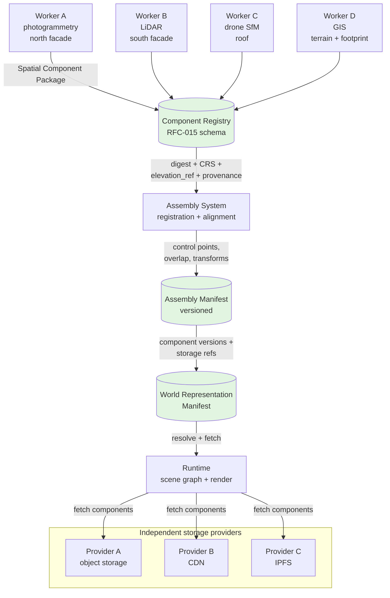

# Chapter 11 — Distributed Spatial Reconstruction and Assembly

**Status:** `SPECIFIED ONLY` — no implementation code yet. This chapter defines the
interfaces, component schema, and assembly rules that a Terra-compatible
reconstruction worker must satisfy. It does not authorize any production
deployment.

**See:** RFC-013 (`docs/rfc-013-spatial-intelligence-pipeline.md`), RFC-014,
`RFC-015` (Spatial Component Package — not yet written), `docs/canonical-geometry-digest.md`,
Chapter 3, Chapter 12, Chapter 13.

---

## 11.1 Why this chapter exists

Terra today can record a spatial asset and append geometry versions on-chain
(`SpatialAsset`, `GeometryVersion`), track 3D model references (`ThreeDModel`),
run a single reconstruction API (`POST /api/v1/reconstruction/jobs`), and
compute a canonical 2D geometry digest (`terra-geom-v1`). It **cannot** yet:

- accept independently produced components from multiple reconstruction engines,
- verify that separate components describe the same physical object,
- assemble accepted components into one coherent building representation,
- store spatial components independently of a central geometry repository,
- stream only the components needed for a particular view.

This chapter specifies what is missing so that Terra becomes a distributed
physical-world infrastructure rather than one monolithic 3D viewer.

---

## 11.2 Design principles

1. **One world, many independent components.** Independently produced and stored
   spatial objects must be interoperable.
2. **Engines are interchangeable.** Terra must not depend on one reconstruction
   engine, one AI model, one vendor, or one GPU architecture.
3. **Assembly is separate from reconstruction.** A worker produces a component;
   Terra's assembly system connects accepted components into a larger
   representation.
4. **Versioned truth claims.** A model is a representation supported by evidence,
   not automatically the physical truth.
5. **Incremental updates.** Replacing one roof or facade must not require
   rebuilding an entire building or region.

---

## 11.3 Spatial component package

Every independently produced component must be delivered through a versioned
**Spatial Component Package**. The package schema is defined in RFC-015
(not yet written). At minimum a package carries:

| Field | Purpose |
|---|---|
| `component_id` | Stable identifier of this component |
| `physical_entity_id` | Stable identifier of the real-world object (parcel, building, terrain tile) |
| `parent_id` / `related_ids` | Relationship-graph references |
| `component_type` | e.g. `footprint`, `roof`, `facade`, `terrain`, `interior` |
| `geometry_artifact` | Off-chain model file (mesh, point cloud, BIM footprint) |
| `format` + `format_version` | e.g. `glb/2.0`, `copc/1.0`, `ifc/4.3`, `geojson/1.0` |
| `geometry_digest` + `digest_algorithm_version` | `terra-geom-v1` (2D) or `terra-geom-v2` (3D) |
| `crs` | Horizontal CRS (EPSG:4326) |
| `elevation_ref` | `EGM2008` / `WGS84-ELLIPSOID` / `local` / `unknown` |
| `vertical_units` | `m` / `ft` |
| `local_frame` | Local ENU frame when applicable |
| `global_transform` | Local-to-global transform |
| `bounding_volume` | Axis-aligned or oriented bounding box |
| `resolution` + `lod` | Resolution and level-of-detail |
| `evidence_refs` | References to source evidence |
| `engine_id` + `engine_version` | Reconstruction engine identity |
| `creation_timestamp` | When the component was produced |
| `resource_usage_receipt` | Metered compute/storage/bandwidth receipt |
| `accuracy` / `uncertainty` | Expected geometric error |
| `provenance_classification` | Imported / observed / surveyed / reconstructed / inferred |
| `dependencies` / `overlap_ids` | Components this depends on or overlaps |
| `privacy_classification` / `access_policy` | Component-level privacy |
| `validation_state` | `pending` / `technically_valid` / `independently_valid` / `rejected` |
| `version_lineage` | Previous component version, if superseding one |

**Conformance rule:** An engine is not Terra-compatible merely because it
exports a GLB or GeoJSON file. It must correctly declare the coordinate frame,
geometry semantics, provenance, accuracy, dependencies and version information,
and its package must pass the RFC-015 conformance test.

---

## 11.4 Reconstruction workflow

A reconstruction job follows these stages:

1. **Capture and ingestion** — source images, LiDAR, survey points, GIS/BIM data.
2. **Evidence validation** — verify the capture is attributable, timestamped, and
   within its stated uncertainty.
3. **Pre-processing** — coordinate normalization, outlier removal.
4. **Coordinate normalization** — express in the declared CRS and elevation
   reference; do not silently mix ellipsoid and geoid heights.
5. **Reconstruction** — photogrammetry, multi-view stereo, SfM, LiDAR processing,
   point-cloud processing, terrain reconstruction, building reconstruction,
   AI-assisted reconstruction, CAD/BIM conversion, GIS integration, manual
   correction, or a hybrid.
6. **Semantic segmentation** — label roof, facade, foundation, terrain, etc.
7. **Component extraction** — split into independently storable components.
8. **Geometry registration** — align to shared spatial anchors (GNSS, surveyed
   control points).
9. **Quality assessment** — registration residual, overlap, boundary mismatch.
10. **Packaging** — emit a Spatial Component Package per RFC-015.
11. **Technical verification** — automated checks (digest, CRS, transform,
    bounding volume).
12. **Domain validation where necessary** — surveyor or institutional sign-off.
13. **Spatial assembly** — connect accepted components into a scene (Chapter 12).
14. **Publication** — register component versions and storage references.
15. **Progressive visualization** — client fetches components by LOD (Chapter 13).
16. **Updates and historical versioning** — new versions, never silent
    overwrites (Section 11.6).

A new component version **must not** automatically become the accepted current
version. It must pass technical and validation conditions first.

---

## 11.5 How separately reconstructed components connect

Different workers may reconstruct the same structure from different directions,
sensors, dates, or coordinate origins. Terra requires a registration and
alignment system:

- **Common control points** and **shared spatial anchors** (GNSS, surveyed
  references).
- **Overlap regions** and **feature correspondences** between components.
- **Local-to-global** and **global-to-local** transforms.
- **Registration quality**: residual errors, confidence, uncertainty.
- **Duplicate geometry detection**, **boundary mismatch detection**, **component
  intersection checks**, **terrain/building consistency**, **conflict detection**.

Alignment methods may include robust feature matching, point-cloud registration,
global adjustment, and surveyed control constraints. **ICP alone does not solve
every alignment problem.** Do not align a building to terrain by placing the
lowest mesh vertex on the ground — consider foundations, basements, sloped
terrain, raised buildings, multi-level structures, retaining walls, bridges,
underground structures, and different elevation datums.

When two outputs cannot safely be merged, preserve both candidates and request
additional processing or validation rather than forcing a merge.

---

## 11.6 Versioning and assembly

- Component versions are **immutable**.
- An **explicit current-version pointer** identifies the accepted version.
- **Version dependencies** record which component versions an assembly depends on.
- **Parent assembly versions** and **supersession relationships** are tracked.
- Validation status transitions: `pending → technically_valid → independently_valid → rejected`.
- Rejected candidates are retained, not deleted.

A new assembly candidate is created only after its component candidates pass
validation. Assembly generation recomputes only the affected relationships,
never an entire region.

---

## 11.6 Diagram — distributed reconstruction & assembly

## 11.7 Connection to existing code

| Existing capability | Reused by this chapter | Gap |
|---|---|---|
| `SpatialAsset` / `GeometryVersion` (on-chain, append-only versions, quorum verify) | Provides on-chain version anchors for component packages | No component package submission or conformance check yet |
| `ThreeDModel` (register + verify, off-chain URI) | Model artifact reference pattern | No component schema, no engine identity, no accuracy/uncertainty fields |
| Reconstruction API (`jobs`, `lease`, `complete`, `draft`, `anchor`) | Single-worker reconstruction flow | No multi-worker submission, no worker registration, no engine negotiation |
| `task_economics.rs` (`FeePolicy`, `CoverageIncentive`, `TaskEscrow`, `RewardAllocation`) | Payment/subsidy primitives | Applies to verification tasks, not reconstruction tasks; needs new task types |
| `routing.rs` (nine-factor, seeded randomness) | Provider selection primitives | Needs reconstruction-task routing and capability gating |
| `canonical.rs` (`terra-geom-v1`, 2D digest) | 2D geometry digest baseline | Rejects 3D ordinates; no 3D digest canonicalization in production code |
| `canonical3d.rs` / `terra-geom-v2` (terra-3d branch only, experimental) | Candidate 3D digest | Not merged; treat as experimental (ADR-016; Chapter 3 §3.3). |

No code changes are made in this task. The deliverable is the specification.